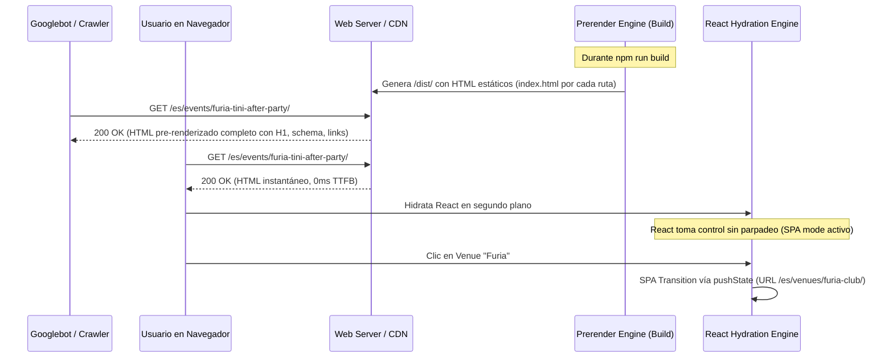

# ARRIVE SEO Architecture: Sistema Técnico de Routing y Renderizado

Este documento describe la arquitectura técnica que permite a ARRIVE operar con máxima velocidad en el navegador mientras entrega HTML 100% rastreable para Googlebot.

---

## 1. Diagrama de Flujo del Sistema

---

## 2. Componentes Clave

### 2.1 Router Híbrido Semántico (`src/router/`)
- Mapea rutas limpias sin hashes para todas las entidades públicas.
- Utiliza la API History de HTML5 (`pushState` y `replaceState`) para una navegación SPA ultra veloz sin recargar toda la página.
- Maneja la apertura y cierre de vistas modales como capas visuales sincronizadas con la URL. Si el usuario copia el link o presiona "Atrás", el historial responde naturalmente.

### 2.2 Motor de Prerenderizado en Build (`scripts/prerender-seo.mjs`)
- Toma el template base compilado por Vite.
- Itera sobre todas las URLs canónicas registradas en el mapa de rutas.
- Para cada ruta, inyecta:
  - Título y Meta Description específicos.
  - Enlace Canónico absoluto.
  - Etiquetas `hreflang` cruzadas.
  - Bloque `@graph` JSON-LD con los datos estructurados correspondientes.
  - Marcado HTML semántico (`<h1>`, `<article>`, `<section>`, `<nav>`, `<a>`).
- Guarda el resultado en `dist/[ruta]/index.html`.

### 2.3 Head Manager Centralizado (`src/seo/HeadManager.js`)
- Durante la navegación en cliente (SPA), actualiza dinámicamente el `document.title`, los `<meta>` tags y el script JSON-LD en el `<head>`, asegurando que compartir el enlace en WhatsApp o redes sociales use la tarjeta Open Graph correcta en cualquier momento.

### 2.4 Generador Automatizado de Sitemaps (`scripts/generate-sitemaps.mjs`)
- Produce sitemaps modulares con fechas de última modificación (`<lastmod>`) y referencias a versiones idiomáticas (`xhtml:link`).
